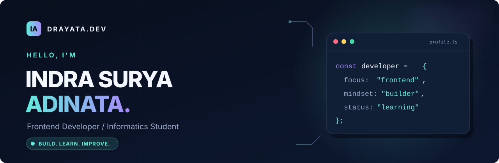
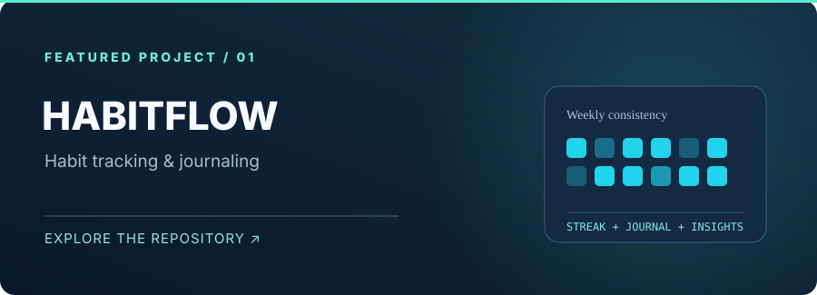
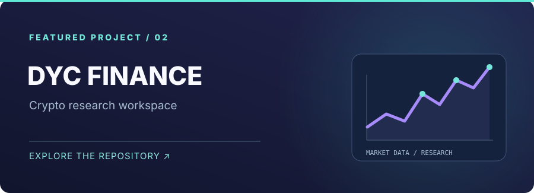

<!--
  INDRA SURYA ADINATA · GITHUB PROFILE README
  GitHub: https://github.com/Drayata
  Personalization checklist:
  1. Verify the projects/skills and edit anything outdated.
  2. Replace YOUR_LINKEDIN_SLUG and YOUR_PUBLIC_EMAIL when ready.
  3. Add the snake workflow in .github/workflows/snake.yml, then run it once.
  4. Keep the assets/ directory alongside README.md.
  5. Optional: remove external dynamic widgets if they become unavailable.
  No JavaScript is used: GitHub READMEs do not run custom scripts.
-->

<div align="center">

<picture>
  <source media="(prefers-color-scheme: dark)" srcset="./assets/hero-dark.svg" />
  <source media="(prefers-color-scheme: light)" srcset="./assets/hero-light.svg" />
  
</picture>

<br />

[](https://git.io/typing-svg)

<a href="https://github.com/Drayata?tab=followers"></a>
<a href="https://github.com/Drayata"></a>


<sub>Developer mindset · Thoughtful interfaces · Continuous learning</sub>

**[About](#-about-me)** · **[Stack](#-tech-stack)** · **[Projects](#-featured-projects)** · **[GitHub Analytics](#-github-analytics)** · **[Beyond Code](#-beyond-the-code)** · **[Connect](#-lets-connect)**

</div>

---

## 👋 About Me

I'm **Indra Surya Adinata**, an Informatics student at **Universitas Jenderal Soedirman (UNSOED), Indonesia**. I enjoy turning ideas into intuitive interfaces and functional software, with a strong interest in **frontend engineering**, modern web development, and thoughtful product experiences.

I care about the details that make software genuinely useful: clear flows, readable code, responsive layouts, and a willingness to rethink the first solution.

<table>
<tr>
<td width="57%" valign="top">

### `whoami`

- 🎓 Studying **Informatics** at UNSOED.
- 🧩 Building with **React, JavaScript, and Tailwind CSS**.
- 🌱 Exploring software architecture, databases, and product development.
- 🛠️ Learning by **building real projects**, iterating, and documenting what works.
- 🤝 Interested in collaborative, open-source, and product-focused work.
- 🎯 Long-term direction: **Software Engineering**.

</td>
<td width="43%" valign="top">

### `developer.ts`

```ts
const indra = {
  username: "Drayata",
  focus: ["Frontend", "Web Apps"],
  values: [
    "Clarity over complexity",
    "Progress over perfection",
    "Build, measure, improve",
  ],
  currentMode: "Always learning",
};
```

</td>
</tr>
</table>

> **My approach:** start with the problem, build a simple working version, then improve it through feedback and better engineering decisions.

---

## 🧰 Tech Stack

A selection of languages, frameworks, and tools I use or have explored. **Tools aren't trophies**—the project and the reasoning behind it matter more.

### Frontend & Design

<p align="left">
  
</p>

### Backend, Data & Core Programming

<p align="left">
  
</p>

### Tools & Environment

<p align="left">
  
</p>

<details>
<summary><b>🔎 View how I use these technologies</b></summary>
<br />

| Area | What I care about | Example tools |
| :--- | :--- | :--- |
| User interfaces | Responsive design, accessibility, interaction patterns | React, Tailwind CSS, Figma |
| Application logic | Understandable state and maintainable modules | JavaScript, TypeScript |
| Data & APIs | Sound data models and clear API contracts | Supabase, SQL, Node.js |
| Development workflow | Versioning, debugging, continuous improvement | Git, GitHub, VS Code |
| Foundations | Algorithms, data structures, understanding how systems work | C, C++, Python |

</details>

---

## 🚀 Featured Projects

Selected builds that reflect my interests in usable interfaces, personal productivity, and data-driven tools.

<table>
<tr>
<td width="50%" valign="top">
<a href="https://github.com/Drayata/habits-journaling-tracker"></a>

### [HabitFlow](https://github.com/Drayata/habits-journaling-tracker)

A modern habit tracker and journal with daily check-ins, mood tracking, progress insights, and a responsive UI.

`React` `Tailwind CSS` `Supabase` `Motion`

**Focus:** UI states · Daily-use experience · Personal productivity

**[Explore repository →](https://github.com/Drayata/habits-journaling-tracker)**
</td>
<td width="50%" valign="top">
<a href="https://github.com/Drayata/dyc-finance"></a>

### [DYC Finance](https://github.com/Drayata/dyc-finance)

A local-first personal crypto research workspace connecting timestamped market data and news to testable swing-trading hypotheses.

`Local-first` `Market Data` `SQLite` `Research`

**Focus:** Data integrity · Explainable analysis · Risk awareness

**[Explore repository →](https://github.com/Drayata/dyc-finance)**
</td>
</tr>
</table>

### Other repositories worth exploring

| Project | What it explores | Link |
| :--- | :--- | :--- |
| **Portfolio Web** | React / Vite portfolio development | [Repository ↗](https://github.com/Drayata/portofolio-web) |
| **DYC Music** | An experiment with a YouTube-based music player | [Repository ↗](https://github.com/Drayata/dyc-music) |
| **Simon Game (React)** | React-based interactive game practice | [Repository ↗](https://github.com/Drayata/simon-game-react) |

<sub>Projects evolve. Repository READMEs and commit histories are the best sources for current implementation details.</sub>

<div align="center">

**[Browse all public repositories ↗](https://github.com/Drayata?tab=repositories)**

</div>

---

## 📊 GitHub Analytics

<div align="center">

<a href="https://github.com/Drayata">
  
</a>
<a href="https://github.com/Drayata?tab=repositories">
  
</a>

<br />

<a href="https://github.com/Drayata">
  
</a>

<br />

<a href="https://github.com/Drayata">
  
</a>

<sub>These cards are generated by community services and may occasionally hit rate limits or become temporarily unavailable. Language usage is not a proficiency score.</sub>

</div>

---

## 🐍 Contribution Snake

A small visualization of consistency—generated automatically from GitHub contributions.

<div align="center">

<picture>
  <source media="(prefers-color-scheme: dark)" srcset="https://raw.githubusercontent.com/Drayata/Drayata/output/github-snake-dark.svg" />
  <source media="(prefers-color-scheme: light)" srcset="https://raw.githubusercontent.com/Drayata/Drayata/output/github-snake.svg" />
  
</picture>

<sub>First-time setup: run the included <code>snake.yml</code> workflow to publish the <code>output</code> branch.</sub>

</div>

---

## 🧭 What I'm Focused On

| Focus | Why it matters | How I'm approaching it |
| :--- | :--- | :--- |
| **Frontend engineering** | Well-built interfaces are fast, understandable, and accessible | Practice with React, component design, responsive layouts |
| **Software fundamentals** | Strong foundations help me learn technologies beyond today's tools | Study algorithms, data modeling, and computer systems |
| **Better development habits** | Quality is a process, not a last-minute step | Version control, documentation, iterative improvements |
| **Product thinking** | Great software solves a real problem | Start with user needs, prioritize essentials, refine with feedback |

<details>
<summary><b>🛠️ Expand: My development workflow</b></summary>
<br />

```text
01. DEFINE     → Understand the problem and constraints
02. DESIGN     → Sketch the user flow and data needs
03. BUILD      → Implement the smallest useful version
04. VERIFY     → Test edge cases, responsiveness, and usability
05. REFACTOR   → Improve structure without changing behavior
06. DOCUMENT   → Explain decisions, trade-offs, and next steps
07. ITERATE    → Use feedback to decide what matters next
```

</details>

<details>
<summary><b>📚 Expand: Topics I'm exploring</b></summary>
<br />

- Component architecture and frontend performance.
- Database design, API integration, and application security basics.
- UI accessibility and consistent design systems.
- AI-assisted development with critical review of generated code.
- Building tools for productivity and analytical decision-making.

</details>

<details>
<summary><b>🤝 Expand: Collaboration interests</b></summary>
<br />

I'm interested in projects where I can contribute meaningful work and learn from other developers—especially **web applications**, **developer tools**, **student-led products**, and **open-source projects with a clear problem to solve**.

The easiest way to start a conversation is through my [GitHub profile](https://github.com/Drayata) or a relevant repository issue.

</details>

---

## 🌿 Beyond the Code

I believe growth compounds when curiosity meets consistency. Outside coursework and development, I enjoy exploring ideas around **productivity, technology, entrepreneurship, and intentional learning**.

> *Make it work. Understand why it works. Then make it better.*

---

## 📬 Let's Connect

<div align="center">

**Have an idea, a question, or an opportunity to collaborate?**

<a href="https://github.com/Drayata"></a>
<a href="https://github.com/Drayata?tab=repositories"></a>

<!-- OPTIONAL: uncomment after adding real public contact details.
<a href="https://www.linkedin.com/in/YOUR_LINKEDIN_SLUG/"></a>
<a href="mailto:YOUR_PUBLIC_EMAIL"></a>
-->

<br /><br />


**Thanks for stopping by. Keep building things that matter.**

<sub>© 2026 Indra Surya Adinata · Crafted with curiosity and attention to detail.</sub>

</div>
